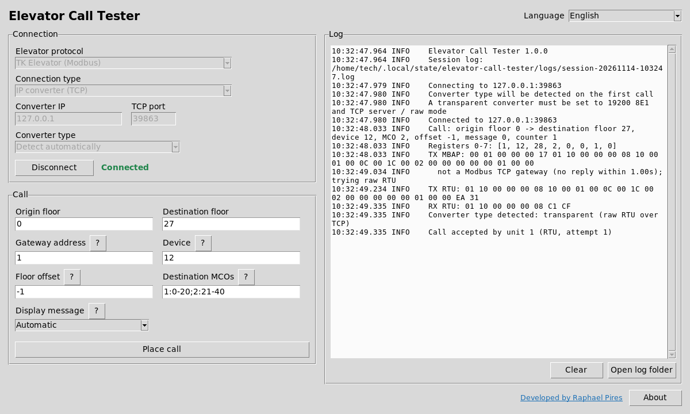
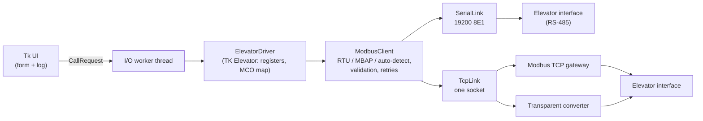

# Elevator Call Tester

[](https://github.com/rphpires/elevator-call-tester/actions/workflows/ci.yml)


A bench and field tool for **elevator destination-call interfaces**. It places a call
(origin floor → destination floor) the way an access control system would, over a serial
line or an IP converter. It then shows every byte on the wire and says plainly whether the
elevator accepted the call.

Built for the moment an installer is in a machine room with a laptop and an RS-485 adapter,
and needs to know whether the problem is the wiring, the converter, the addressing or the
floor mapping, without the access control system in the loop.



## What it does

- **Places destination calls** over Modbus: write 8 holding registers (function `0x10`)
  laid out by the manufacturer protocol. TK Elevator is supported today.
- **Three transports, one call:** a serial line (Modbus RTU, 19200 8E1), a Modbus TCP
  gateway (MBAP framing), or a transparent serial-to-TCP converter (raw RTU over a socket).
- **Detects the converter type on the first call.** Both kinds look identical at TCP
  connect, so the tool probes MBAP, then raw RTU, and remembers what answered.
- **Validates every reply**: CRC, slave or unit id, MBAP transaction id, echoed address and
  quantity, and Modbus exception codes with their names ("gateway target device failed to
  respond" is a very different field problem from "illegal data address").
- **Session log file** for each run, so a technician can attach it to a support ticket.
- **UI in English and Brazilian Portuguese** (it picks the system language). It remembers
  the last values used.
- **Built-in simulator** of both converter types, to try the tool or run the tests without
  hardware.

## Quick start

```bash
python -m venv .venv
.venv/bin/pip install -e ".[dev]"          # Windows: .venv\Scripts\pip ...

# Terminal 1: a simulated transparent converter with the elevator behind it
.venv/bin/elevator-call-simulator --mode transparent --port 5020

# Terminal 2: the app. Choose "IP converter (TCP)", 127.0.0.1, port 5020, Connect, Place call.
.venv/bin/python -m elevator_call_tester
```

On Linux, tkinter comes from the distribution (`sudo apt install python3-tk`). Windows
users can run the packaged executable; see [docs/building.md](docs/building.md).

## How a call travels



The protocol, the transport and the UI are separate layers. A new manufacturer is a new
`ElevatorDriver` subclass: it declares its form fields, and the UI renders them. See
[docs/architecture.md](docs/architecture.md).

## The TK Elevator call

| Register | Content |
|---:|---|
| 0 | Origin floor − floor offset |
| 1 | Device (terminal) number at the origin |
| 2 | Destination floor − floor offset |
| 3 | Destination MCO, resolved from the MCO map |
| 4 | Mode + type (fixed `0`) |
| 5 | Call parameter (fixed `0`) |
| 6 | Call counter (wraps at 65536) |
| 7 | Display message (`0` none, `2` already on this floor, `11` access denied) |

The **MCO map** says which MCO serves which destination floor:

```
1:4,6,7-18;2:20-99
```

MCO 1 serves floors 4, 6 and 7–18; MCO 2 serves 20–99. An entry without floors (`2`) is
the default for floors that are not listed. Negative floors work (`1:-2-5`). Malformed
ranges are rejected, and overlaps raise a warning instead of passing silently.

Full byte-level description, with example frames: [docs/protocol.md](docs/protocol.md).

## Documentation

| | |
|---|---|
| [Field guide](docs/field-guide.md) | Step by step on site: wiring, converter settings, first call |
| [Troubleshooting](docs/troubleshooting.md) | What each log message and exception code means, and what to check |
| [Protocol](docs/protocol.md) | Registers, framings, example frames, detection, retries |
| [Architecture](docs/architecture.md) | Layers, threading, how to add a manufacturer |
| [Building](docs/building.md) | Tests, lint, Windows executable |

## Development

```bash
.venv/bin/pytest          # 70+ tests; real sockets against the simulator, no hardware needed
.venv/bin/ruff check .
.venv/bin/ruff format --check .
python scripts/ui_smoke.py --mode gateway   # drives the real Tk window end to end
```

CI runs lint and tests on Linux and Windows for Python 3.10 and 3.13.

## Project layout

```
elevator_call_tester/
  crc.py          CRC-16/MODBUS
  modbus.py       RTU and MBAP frames, reply validation, ModbusClient (retries, detection)
  links.py        SerialLink and TcpLink: bytes only
  drivers/        ElevatorDriver interface + the TK Elevator driver
  simulator.py    Gateway / transparent converter simulator
  ui/             Tk window and the single I/O worker thread
  i18n.py         English and Brazilian Portuguese strings
tests/            pytest suite
docs/             Guides and protocol notes
```

## Disclaimer

This project is not affiliated with, or endorsed by, any elevator manufacturer.
Manufacturer names appear only to identify the protocols involved. Placing calls on a live
elevator system must be coordinated with whoever is responsible for that installation.

## License

[MIT](LICENSE) © Raphael Pires
